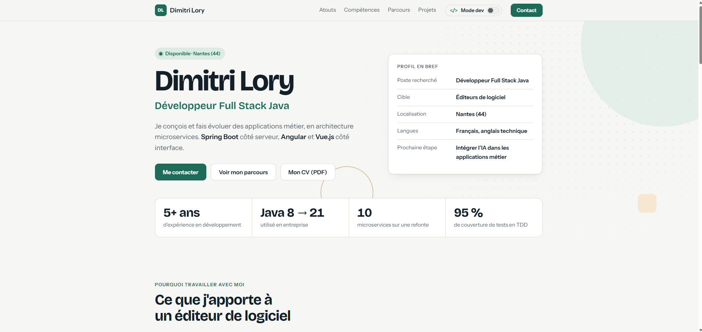
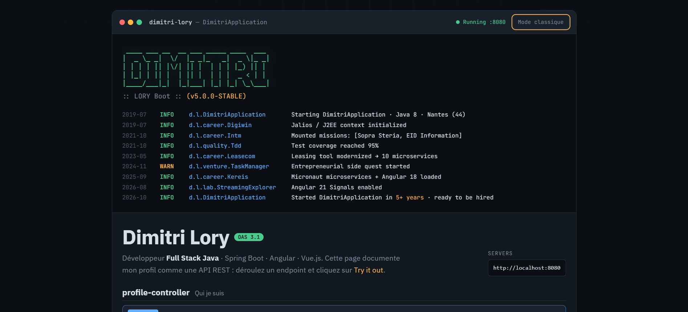

# Portfolio · Dimitri Lory

Portfolio de **Dimitri Lory, développeur Full Stack Java** (Spring Boot · Angular · Vue.js) basé à Nantes.
Un seul site, deux lectures : une version claire pour les recruteurs, et un **mode développeur** pour les profils techniques.

🔗 **En ligne :** https://dimitrilory44.github.io
💻 **Mode développeur direct :** https://dimitrilory44.github.io/#dev

| Version classique | Mode développeur |
|---|---|
|  |  |

## Deux modes, un seul site

- **Version classique** : profil en bref, chiffres clés, compétences, frise du parcours, projets, formation et contact. Pensée pour être comprise en une minute.
- **Mode développeur** : le portfolio démarre comme une application Spring Boot (bannière ASCII et logs de démarrage qui retracent le parcours), puis le profil se consulte comme une **API documentée façon Swagger** (`GET /api/v1/experiences`, `GET /actuator/health`, `POST /api/v1/hire`…). Un **terminal interactif** permet aussi de taper des commandes (`help`, `whoami`, `skills`…).

La bascule se fait par un interrupteur dans la navigation. L'ancre `#dev` permet de partager directement le mode développeur.

## Stack

**HTML, CSS et JavaScript, sans framework ni étape de build.**

C'est un choix volontaire : le site est statique, sans état à gérer ni données à synchroniser, donc un framework comme Angular n'apporterait que du poids et une chaîne de build. Le site se résume à cinq fichiers et se déploie tel quel sur GitHub Pages.

La seule ressource externe est Google Fonts, avec des polices de repli système.

## Fonctionnalités

- **Bascule de mode** avec transition animée et lien partageable (`#dev`)
- **Squelette de chargement** affiché pendant le chargement de la page
- **Apparition progressive des blocs** au défilement (`IntersectionObserver`), sans jamais masquer ce qui est déjà visible à l'ouverture
- **Effet parallax** dans l'en-tête et sur les aperçus de projets (`requestAnimationFrame`)
- **Bouton retour en haut** avec anneau de progression de lecture
- **Thème clair / sombre** automatique selon les préférences du système (variables CSS)
- **Documentation d'API simulée** : réponses JSON colorées, commandes `curl`, bouton *Try it out*
- **Terminal** avec historique (↑ / ↓) et autocomplétion (Tab)
- **Mise en page responsive**, du mobile à l'écran large

## Accessibilité

- Toutes les animations sont désactivées pour les visiteurs qui ont activé la réduction des animations (`prefers-reduced-motion`)
- Navigation complète au clavier, avec un focus visible
- Attributs ARIA sur les éléments interactifs (sections dépliables de l'API, boutons, zones décoratives masquées)
- La version classique reste entièrement lisible même si le JavaScript ne se charge pas

## Organisation du code

```
index.html   Structure des deux modes
style.css    Version classique et interrupteur de mode
script.js    Animations, bascule de mode, retour en haut
dev.css      Styles du mode développeur, isolés sous #dev
dev.js       API simulée, logs de démarrage et terminal
img/         Images du site
```

Les styles du mode développeur sont tous préfixés par `#dev`, pour que les deux versions cohabitent sans conflit.

## Lancer en local

Aucune installation n'est nécessaire : ouvrez `index.html` dans un navigateur.

Pour un rendu identique à la version en ligne, vous pouvez aussi lancer un petit serveur local :

```bash
python -m http.server 8000
```

puis ouvrir http://localhost:8000.

## Contact

- LinkedIn : https://www.linkedin.com/in/dimitri-lory
- E-mail : lorydim44@gmail.com
